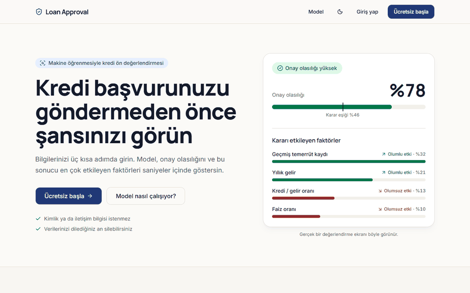
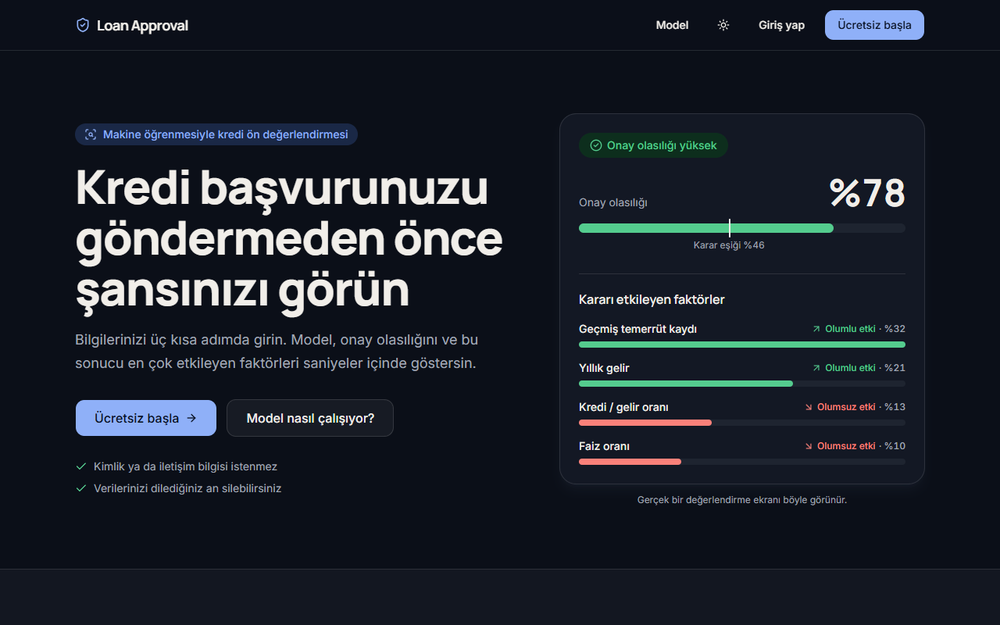
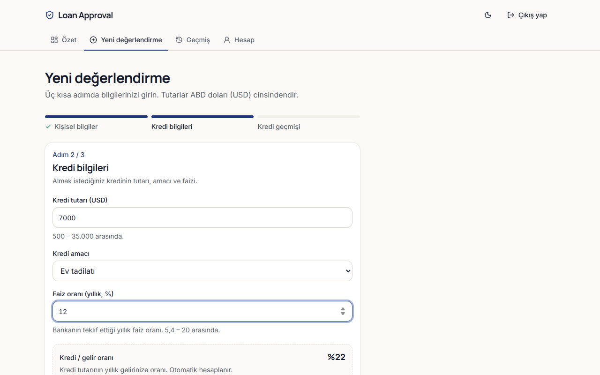
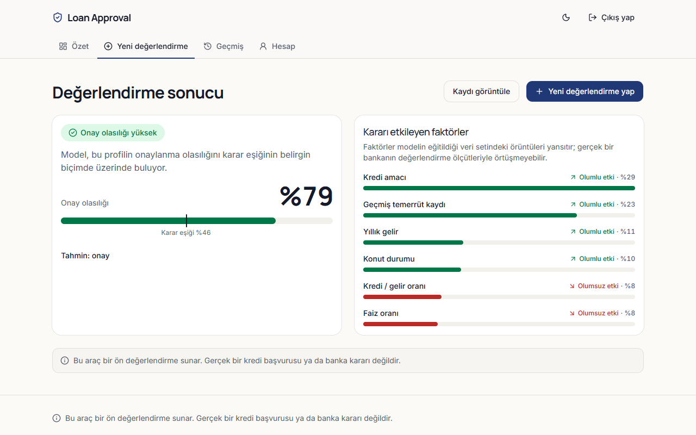
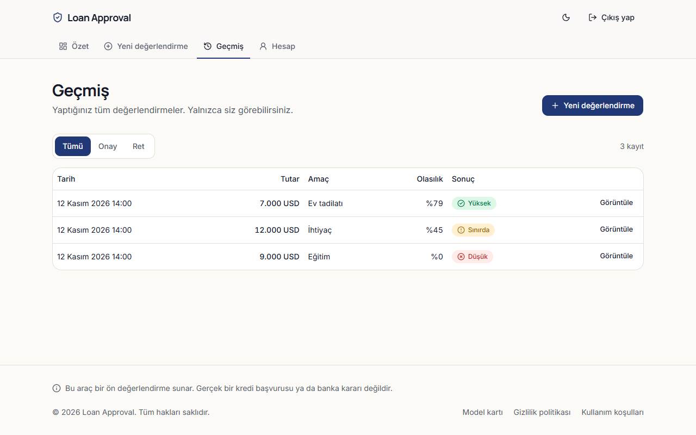
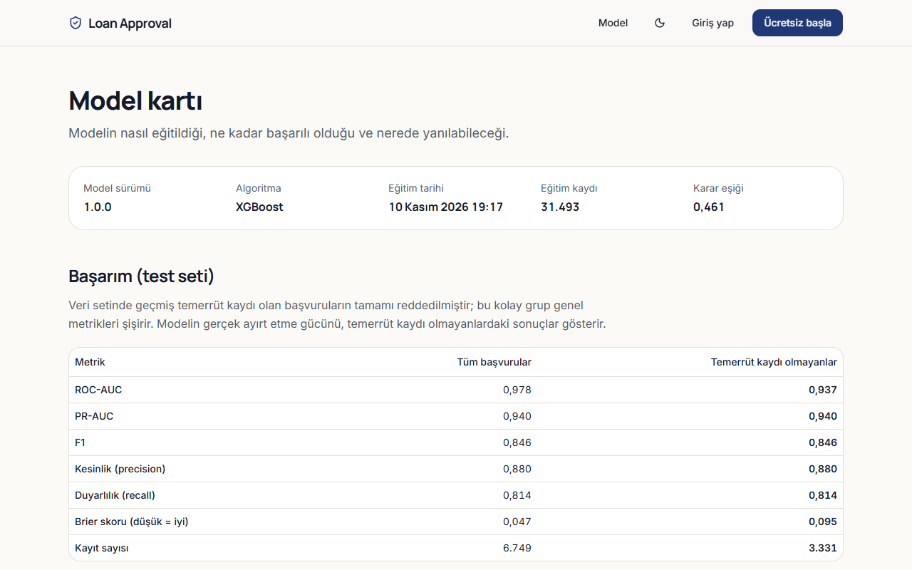
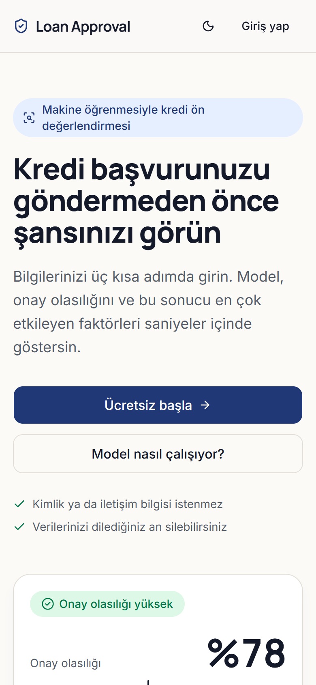
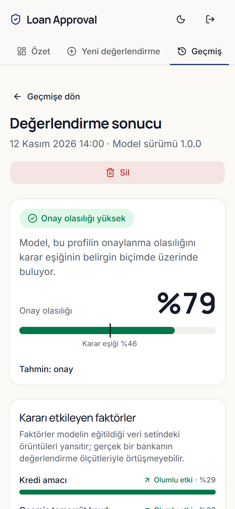
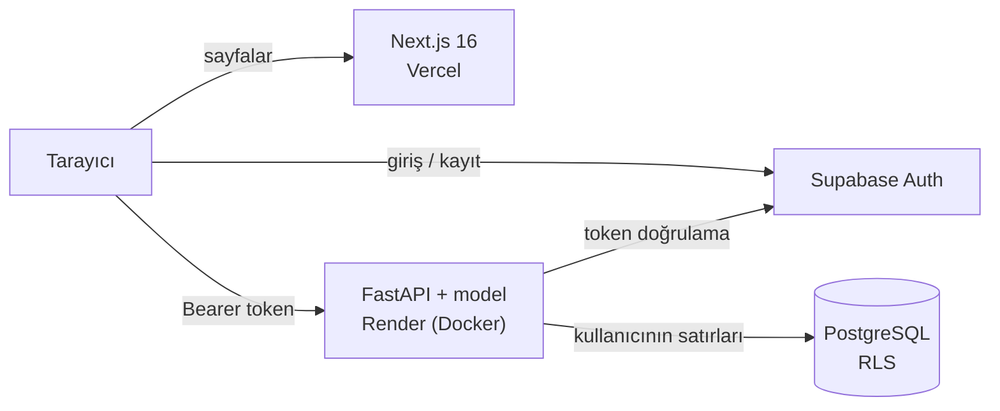

# Loan Approval

Kişisel ve kredi bilgilerine göre bir kredi başvurusunun **onaylanma olasılığını** tahmin eden, sonucu **hangi bilgilerin ne yönde etkilediğini** gösteren kredi ön değerlendirme aracı. Uçtan uca bir ürün: eğitilmiş XGBoost modeli, FastAPI servisi, kullanıcı hesapları ve geçmiş, Türkçe bir web arayüzü; canlıda çalışıyor.

**Canlı:** [loan-approval-navy.vercel.app](https://loan-approval-navy.vercel.app) · API: [loan-approval-api-m2wc.onrender.com](https://loan-approval-api-m2wc.onrender.com/docs)

> **Uyarı:** Bu araç bir ön değerlendirme sunar. Gerçek bir kredi başvurusu ya da banka kararı değildir. Model açık ve sentetik bir veri setiyle eğitilmiştir ve Türkiye'deki bankaların kriterlerini yansıtmaz.



## Neler var?

- **Açıklanabilir tahmin:** onay olasılığı, karar eşiği ve kararı en çok etkileyen faktörler (yön ve pay ile).
- **Dürüst metrikler:** veri setinin yarısı tek bir kolonla kusursuz ayrıştığı için tüm metrikler hem genel hem de bu kolay grup dışarıda bırakılarak raporlanır ([model kartı](docs/model-karti.md)).
- **Hesaplar ve geçmiş:** Supabase Auth ile kayıt/giriş/şifre sıfırlama; her tahmin hesaba kaydedilir, kullanıcı tek tek ya da topluca silebilir.
- **Kullanıcı verisi korunur:** backend kimliği yalnızca doğrulanmış token'dan alır, veritabanında her tabloda Row Level Security açıktır, başkasının kaydı "yok" gibi görünür.
- **Adalet denetimi:** cinsiyet modele girmez; test setinde kararların cinsiyete göre dağılımı ayrıca denetlenmiştir.
- **Erişilebilir ve duyarlı arayüz:** açık/koyu tema, mobil öncelikli, klavye ile gezinme, karar yalnızca renkle değil metin ve ikonla da gösterilir. Lighthouse (mobil, herkese açık sayfalar): erişilebilirlik 100, performans 99–100.

## Ekran görüntüleri

| | |
|---|---|
|  |  |
|  |  |
|  |  |

<p>
  
  
</p>

## Mimari



Frontend veritabanına doğrudan erişmez; tüm veri işlemleri API üzerinden geçer. Ayrıntılar, tahmin akışı ve model hattı: [docs/mimari.md](docs/mimari.md).

## Model

| Test seti | Tüm başvurular | Temerrüt kaydı olmayanlar |
|---|---|---|
| ROC-AUC | 0,978 | **0,938** |
| F1 | 0,846 | 0,846 |
| Brier skoru | 0,047 | 0,095 |

XGBoost; Logistic Regression, Random Forest ve LightGBM ile aynı test setinde karşılaştırıldı. Karar eşiği doğrulama setinde seçildi, olasılıkların kalibrasyonu test edildi, açıklamalar `pred_contribs` ile üretiliyor (SHAP ile birebir aynı). Tüm ayrıntılar, sınırlamalar ve adalet denetimi: **[docs/model-karti.md](docs/model-karti.md)**.

**Bilinen sınırlama:** veri setinde "onay" etiketi gerçek kredi mantığına ters ilişkiler içeriyor (örneğin daha düşük gelir, onay olasılığını artırabiliyor). Model bunu aynen öğrendi; sınırlama arayüzde ve model kartında açıkça belirtiliyor.

## Teknolojiler

| Katman | Teknolojiler |
|---|---|
| Makine öğrenmesi | Python 3.13, pandas, scikit-learn, XGBoost, LightGBM, Optuna, SHAP, Jupyter |
| Backend | FastAPI, Pydantic v2, SQLAlchemy 2, Alembic, PyJWT (JWKS), slowapi, Docker |
| Veri ve kimlik | PostgreSQL ve Auth (Supabase), Row Level Security |
| Frontend | Next.js 16 (App Router), TypeScript, Tailwind CSS 4, shadcn/ui, react-hook-form, zod, TanStack Query |
| Altyapı | Vercel, Render, GitHub Actions |

## Depo yapısı

| Klasör | İçerik |
|---|---|
| `ml/` | Veri analizi (4 notebook), ortak kod (`loan_ml`), eğitim scripti, raporlar |
| `backend/` | FastAPI servisi, model paketi, Alembic migration'ları, testler |
| `frontend/` | Next.js arayüzü |
| `docs/` | [Mimari](docs/mimari.md), [model kartı](docs/model-karti.md), [canlıya alma rehberi](docs/canliya-alma.md), ekran görüntüleri |
| `PROJE_PLANI.md` | Kararlar, fazlar ve gerekçeler |

## Kalite

- **94 backend testi:** doğrulama kuralları, tahmin akışı, token doğrulama (süresi dolmuş, yanlış imzalı, yanlış hedefli, imzasız), kullanıcılar arası erişim ayrımı, hız sınırı, hata biçimi.
- **CI (GitHub Actions), her PR'da:** backend `ruff` + `pytest` + Docker imajı derleme ve duman testi; frontend `eslint` + tip kontrolü + üretim derlemesi.
- **Canlı veritabanında doğrulanmış erişim kuralları:** bir kullanıcı başkasının kaydını göremez, silemez, değiştiremez; anonim erişim hiçbir tahmin göremez.
- **Sızıntı taraması:** canlı sitenin tarayıcıya gönderdiği tüm JS dosyaları gizli anahtar ve bağlantı dizgisi açısından taranmıştır.

## Yerel çalıştırma

Gereksinimler: [uv](https://docs.astral.sh/uv/) (Python 3.13'ü kendisi kurar), Node.js 24, bir Supabase projesi.

```powershell
# Modeli yeniden eğit ve paketle
cd ml
uv sync
uv run python src/train.py

# Backend: testler ve yerel sunucu
cd ../backend
uv sync
uv run pytest
uv run uvicorn app.main:app --reload     # API belgeleri: http://127.0.0.1:8000/docs
```

Ortam değişkenleri için `backend/.env.example`, kurulum ayrıntıları için [canlıya alma rehberi](docs/canliya-alma.md). Arayüz için ayrı bir terminalde:

```powershell
cd frontend
npm install
Copy-Item .env.example .env.local   # değerleri Supabase projenize göre doldurun
npm run dev                          # http://localhost:3000
```

## Veri seti

`ml/data/raw/loan_data.csv` — 45.000 satır, 14 kolon.

- **Kaynak:** [Loan Approval Classification Dataset](https://www.kaggle.com/datasets/taweilo/loan-approval-classification-data) — Ta-wei Lo, Kaggle
- **Lisans:** [Apache 2.0](https://www.apache.org/licenses/LICENSE-2.0)
- **SHA-256 (ilk 16 karakter):** `67cca604cd71cbd6`

Dosya değiştirilmeden repoda tutulur. Veri sentetiktir; gerçek kişi ya da gerçek kredi sonuçları içermez.

## Sürümler

Değişiklik geçmişi için [CHANGELOG.md](CHANGELOG.md). Şu anki sürüm: **v1.0.0** (model v1.0.0).
