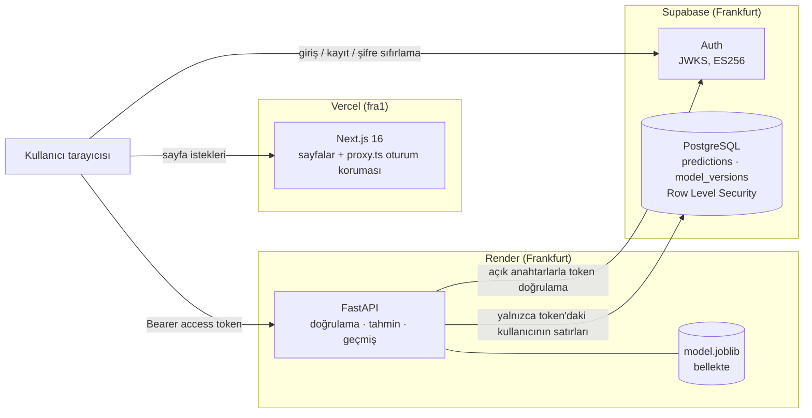
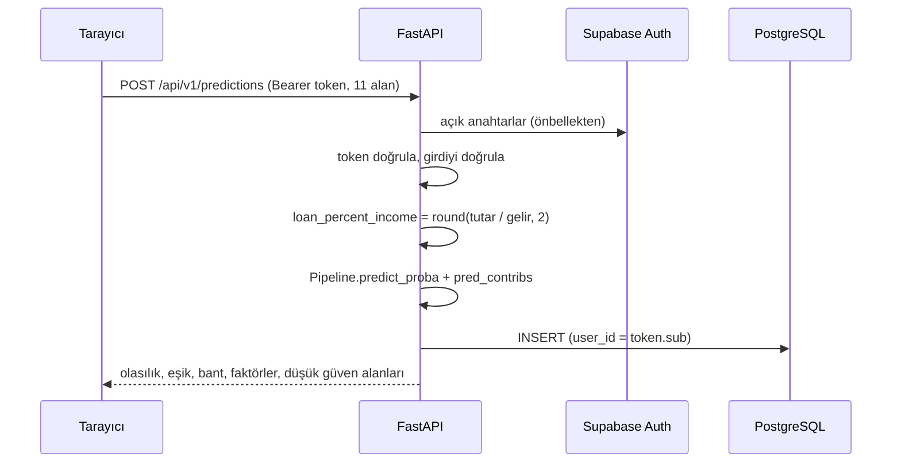
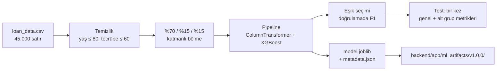

# Mimari

Bu belge sistemin parçalarını ve aralarındaki veri akışını anlatır. Karar gerekçeleri için [PROJE_PLANI.md](../PROJE_PLANI.md), canlıya alma adımları için [canliya-alma.md](canliya-alma.md) dosyasına bakın.

## Çalışma zamanı

Önemli kararlar:

- **Frontend veritabanına doğrudan erişmez.** Supabase tarayıcıda yalnızca kimlik doğrulama için kullanılır; tüm veri işlemleri FastAPI üzerinden geçer.
- **Kullanıcı kimliği yalnızca doğrulanmış token'dan gelir** (`sub` alanı). İstek gövdesindeki hiçbir alana kullanıcı kimliği olarak güvenilmez.
- **İki savunma hattı:** backend her sorguyu `user_id` ile filtreler; veritabanı ise her tabloda Row Level Security ile kullanıcıyı yalnızca kendi satırlarına sınırlar. Backend RLS'i aşan sunucu rolüyle bağlandığı için RLS, backend dışından gelebilecek erişimler (Supabase'in otomatik API'si) için güvenlik ağıdır.
- **Başkasının kaydı var olmayan kayıtla aynı görünür:** iki durumda da birebir aynı `404` döner.
- **Girdi sınırları modelden gelir:** izinli değerler ve aralıklar `metadata.json` içinde durur; API şeması bunları oradan okur, kodda sabit yazılı değildir. Cinsiyet gibi tanımsız alanlar `422` ile reddedilir.
- **Kişisel veri loglanmaz:** gelir, kredi skoru gibi girdiler hiçbir logda yer almaz.

## Tahmin akışı

Açıklama (faktörler) için `shap` kütüphanesi sunucuya kurulmaz: XGBoost'un yerleşik `pred_contribs` çıktısı kullanılır ve one-hot kolonların katkıları özgün özelliğe toplanır. Notebook'larda bu çıktının SHAP `TreeExplainer` ile birebir aynı olduğu doğrulanmıştır.

## Model hattı

`ml/src/train.py` tek komutla paketi yeniden üretir. Eğitim ve canlı tahmin **aynı `Pipeline` nesnesini** kullanır; bu yüzden ön işleme farkından doğan eğitim/servis uyumsuzluğu olmaz. `scikit-learn` ve `xgboost` sürümleri `ml/` ve `backend/` ortamlarında aynıdır ve backend, `metadata.json` içindeki sürümler kurulu olanla eşleşmezse modeli yüklemeyi reddeder.

## Veritabanı

| Tablo | Amaç | RLS |
|---|---|---|
| `predictions` | Girdiler, olasılık, eşik, karar, faktörler (JSONB); `user_id → auth.users` (`ON DELETE CASCADE`) | Kullanıcı yalnızca kendi satırlarını okur ve siler. INSERT/UPDATE politikası yoktur: tahminleri yalnızca backend yazar. |
| `model_versions` | Yüklü model paketinin kaydı (sürüm, algoritma, metrikler, eşik, veri özeti, aktiflik) | Herkes okuyabilir. |
| `alembic_version` | Migration bookkeeping | Politikasız RLS: API'den erişim yok. |

Şema yalnızca Alembic migration'larıyla değişir; RLS politikaları da migration içinde SQL olarak yazılır.

## Ortamlar

| | Geliştirme | Canlı |
|---|---|---|
| Frontend | `localhost:3000` | Vercel, `main` dalından |
| Backend | `localhost:8000` | Render (Docker), `main` dalından, CI yeşilse |
| Veritabanı + Auth | Supabase `loan-approval-dev` | Supabase `loan-approval-prod` |

Dallar: `feature/*` → PR → `dev` → PR → `main`. Her PR'da GitHub Actions: backend `ruff` + `pytest` + Docker imajı derleme ve duman testi; frontend `eslint` + tip kontrolü + üretim derlemesi.
